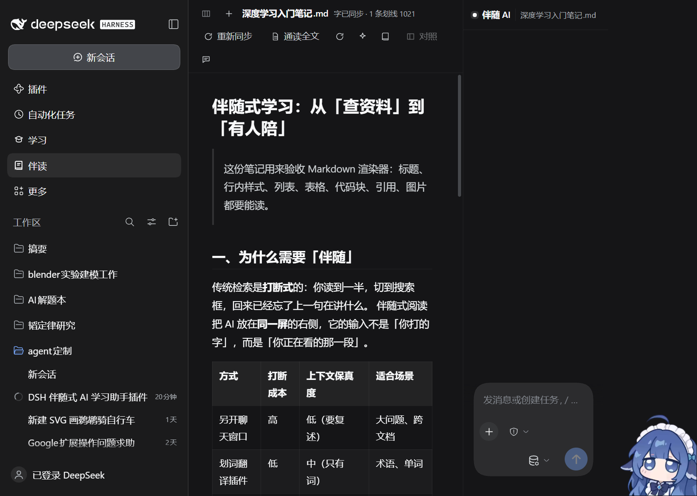
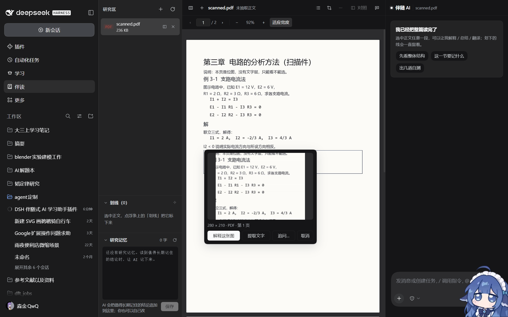

# DocMate 伴读 — 沉浸式研究区

> 把要深读的文档**拖进面板**，AI 先通读全文，然后陪你在正文里逐段抠细节。
> 每篇文档一条独立会话、一份研究记忆。没有知识树，没有知识库，只有你拉进来的东西。

*An immersive reading desk for [DeepSeek Harness](https://github.com/deepseek-ai): drop a document in the centre, and a companion AI on the right has already read all of it — select any sentence to ask, or drag a box over a scanned page and let it look.*



## 它是怎么工作的

```
左栏 研究区            中央 阅读区                右栏 伴随 AI
┌──────────────┐   ┌──────────────────────┐   ┌────────────────┐
│ 拖进来的文档  │   │  md / docx / pdf     │   │ 这篇文档的会话  │
│ 划线（可跳回）│   │  （可并排对照两篇）   │   │ 划词 → 提问     │
│ 研究记忆      │   │  划词 → 解释/划线     │   │                │
└──────────────┘   └──────────────────────┘   └────────────────┘
```

一次「打开文档」做三件事：

1. **建/复用一条普通 DSH 会话**，cwd 指向这篇文档自己的目录。
2. **把全文 + 研究记忆 + 已有划线注入这条会话**（`agent.inject()`，不唤醒 agent，等你问第一句时才进下一步）。
   - 全文 ≤ 24000 字：整篇塞进去。
   - 更长：塞前 24000 字 + 提示「剩下的用 `docmate_read` 按 offset 读」。
3. 之后你划中哪段，就把那段原文连同出处、**以及你此刻正在看的段落**作为一条普通用户消息发进去。

## 安装

```bash
# 从 npm 装（推荐）
dsh plugin --profile <你的 profile> add dsh-docmate

# 或者从本地目录装（开发用）
plugin_manager install_bundle  <本仓库路径>
```

装完重启 Harness / 刷新页面，左侧栏会多一个「**伴读**」入口。

- 需要 DSH `>= 0.2.2-rc.1`（`package.json` 的 `engines.dsh`）。
- 不需要任何 API key：它复用宿主已经配好的模型。
- 数据只写在 `<DSH_HOME>/docmate/`（默认 `~/.dsh/docmate/`），不碰你的其它文件。

## 阅读区：公式 / 目录 / 搜索 / 阅读位置

| 能力 | 怎么用 | 实现要点 |
| --- | --- | --- |
| **数学公式排版** | 文档里的 `$…$` / `$$…$$` 自动排成真正的公式 | 渲染器只留 `[data-tex]` 占位，`45-math.js` 在提交后把没排过的交给 **KaTeX**（`assets/katex/katex.min.js`，277 KB，首次出现公式才拉）。样式和字体复用宿主前端自带的那套，插件不重复塞 250 KB 字体。排不出来就保留等宽原文，不会白屏。 |
| **文档目录** | 顶栏列表图标 → 浮层目录，点一行平滑跳过去 | 直接扫渲染后的 `h1..h6`，不改 markdown 渲染器；层级做归一化（只有 h2/h3 的文档最浅一级顶格）；滚动时高亮当前小节。PDF 走 pdf.js 的 outline，带页码跳转。 |
| **文档内搜索** | `Ctrl/Cmd+F`，或 ⋯ 菜单「在文档里搜索」 | 跨文本节点拼接后匹配（`<strong>` 切句、KaTeX 拆 span 都能命中），用 CSS Custom Highlight API 画命中；跳过 KaTeX 的 MathML 副本，避免同一处命中两次。 |
| **阅读位置记忆** | 无感：切走再回来、刷新页面都回到原处 | 每篇文档一个 `localStorage` 键 `docmate.pos.<id>`；正文是异步读的，所以等容器真的长出内容再恢复，公式排完版高度变了会再对齐一次（用户先滚了就不抢）。 |
| **空白会话起手牌** | 伴随栏第一次打开时的三张牌 | 点一下就直接发问；问过第一条后收起，记在 `docmate.chatstarted.<id>`，刷新也不会再冒出来压住历史。 |
| **导出笔记** | ⋯ 菜单 →「导出笔记」 | 把这篇文档的研究记忆 + 全部划线（含备注、时间）拼成一个 md 直接下载，文件名 `<文档名>-伴读-<时间>.md`，方便丢回 Obsidian。 |
| **注入透明度** | 顶栏标题右侧那行小字 | 文档超过注入上限（24000 字）时显示「N 字 · 注入前 24000 字」，鼠标悬停说明剩下的由 AI 用 `docmate_read` 按需读取——不再笼统写「已同步」。 |
| **框选截图问 AI** | 顶栏裁剪图标（或伴随栏「开始框选」）→ 在正文里拖一个框 | 给**扫描件 / 图片**这种没有文字层、划不了词的材料用。取图优先级：PDF 页 canvas 位图裁剪（跨页按相对位置拼接）→ `` 原图裁剪 → 正文用 SVG `foreignObject` 兜底。抓到后弹一张卡：解释这张图 / 提取文字 / 追问…；截图同时存进 `docs/<id>/shots/`（模型看不到路径，避免它去翻文件）。 |
| **识图提问的刹车** | 无感：带图片的那一轮自动进「快速只读识图」模式 | 用宿主真实的 waterfall 给这一轮装硬限制：最多 2 步（第 3 步起 `reject`）、单步输出 4000、整轮新增 token 30K 预算、**所有工具调用在 dispatch 前被拒**（真的不执行）、45 秒超时取消真实 turn。被拦下时伴随栏会说明原因和用量。实测同一张扫描件从 **16 步 / 882K token** 降到 **2 步 / 25 秒**。 |
| **三栏宽度可拖拽** | 拖动两栏之间的分隔条；双击恢复默认 | 左栏 176–520、右栏 268–640、中间阅读区永远 ≥ 380（面板窄了先收右栏再收左栏）。方向键 ±16px、Home/End 到极值、Enter 复位；宽度和折叠状态一起存在 `docmate.panes`。 |
| **默认精简的回答** | 无感：每篇文档的会话里带一条「回答风格」 | 先一句话结论、最多 3 条要点、正文 ≤150 字；只有你说「展开 / 详细讲 / 逐句」才写长文。不复述原文、不写「我按你的要求没有…」这类过程说明。一键解读 / 起手牌 / 框选提问的问句也都按短回答写。 |



## 划线（持久化）

选中一段 → 浮条上点「划线」→ 选 **重点 / 疑问 / 待复习**。刷新、重启、换设备都还在。

- 锚点是**字符偏移**（`scope: 'doc'` 相对阅读区，`scope: 'page'` 相对 PDF 页），不是像素，所以缩放/换宽度不会漂。
- 渲染用 **CSS Custom Highlight API**（`::highlight(dm-hl-key)` 等），完全不碰 React 管的 DOM。
- 左栏「划线」列表：按颜色筛选、点一条**跳回原文**、可加备注、可「就这条问 AI」、可「让 AI 看看我划的这些」。
- **每次提问自动留痕**：你问过的原文会作为一条「引用」记录存下来，所以回答永远能回溯到原文位置。

## 三个模型工具

| 工具 | 作用 |
| --- | --- |
| `docmate_read` | 读研究区任意一篇文档的正文，支持 `offset` / `limit` 分段。默认读当前会话对应的那篇。 |
| `docmate_memory` | 读写这篇文档的「研究记忆」（`memory.md`）。`append` 会自动加时间戳。 |
| `docmate_highlights` | 读出这篇文档的划线（可按 重点 / 疑问 / 待复习 / 引用 筛选）。复习排期就靠它。 |

三个工具都带 `when` 条件：**只在研究区会话里可见**，别的会话不会多出用不上的工具。

## 记忆：三层

1. **注入**：打开文档时把全文 + 记忆 + 划线塞进会话。
2. **自动流水**：每轮对话结束（`session/event` 的 `turn/end`）自动往 `memory.md` 追加一行
   `- [时间] （自动）问：… ｜ 答：…`，最多 30 条，旧的先删。注入的全文不会被误记成提问。
3. **主动沉淀**：顶栏「沉淀记忆」让 AI 回顾对话、把结论写进记忆；每问满 6 个问题还会自动带一句提醒。

## 复习与对照

- **安排复习**（顶栏书本图标）：用 DSH 的 `schedule` 服务建一条每日任务，到点把
  「用 `docmate_highlights` 读出「待复习」划线，逐条考我」投进这篇文档的会话。
- **对照提问**（并排两篇时出现）：一句话让 AI 对照两篇回答，需要另一篇正文时它自己
  `docmate_read` 过去取。
- **PDF 划线跳转**：目标页没渲染时先让 PdfViewer 翻到那一页，再定位文本范围。

## 数据落在哪

```
<DSH_HOME>/docmate/
  index.json               # 文档列表（顺序、字数、会话 id）
  docs/<id>/source.<ext>   # 你拖进来的原始字节
  docs/<id>/text.md        # 规范化全文（AI 读的是它）
  docs/<id>/memory.md      # 这篇文档的研究记忆
  docs/<id>/highlights.json# 划线 + 引用记录
  docs/<id>/shots/         # 框选截图的原图
```

`<DSH_HOME>` 默认是 `~/.dsh`。会话的 cwd 就是这个 `docs/<id>/` 目录，所以 AI 用普通
`read` 工具也能直接看到这些文件。

## 支持的格式与正文抽取

| 格式 | 渲染 | 全文抽取 |
| --- | --- | --- |
| `.md` / `.markdown` | 客户端 React 渲染 | 原文 |
| `.txt` / `.json` / `.csv` / `.yaml` | 等宽纯文本 | 原文 |
| `.html` / `.htm` | 纯文本 | HTML → Markdown |
| `.docx` | Host 半转语义 HTML（图片内联） | OOXML → Markdown（标题/列表/表格保留结构） |
| `.pdf` | pdf.js 画布 + 自算文本层（含 CJK cMap） | **浏览器**用 pdf.js 抽全文后回传 |

PDF 的正文只能由浏览器抽（Host 没有 PDF 文本引擎），所以拖入 PDF 时面板会先渲染、
再用 pdf.js 逐页抽文本 POST 回 Host。扫描版 PDF 抽不出字，会明确降级成「只能框选截图提问」。

## Obsidian 方言

很多人的笔记来自 Obsidian，所以阅读区按 Obsidian 的语义渲染，而不是把语法原样吐出来：

| 语法 | 渲染 |
|---|---|
| `---` YAML frontmatter | 顶部可折叠属性条，`tags` 变成 chip |
| `> [!info] 标题` / `[!warning]-` | 彩色 callout（蓝/绿/黄/红/灰五组），`-` 默认折叠、标题可点 |
| `[[目标]]` `[[目标\|别名]]` `[[#标题]]` | 可点链接；`#标题` 会滚到对应标题 |
| `![[图片.png]]` | 占位 chip（不加载） |
| `==高亮==` | `<mark>` |
| `#标签` | 标签 chip（带误伤防护） |
| `%%注释%%` | 不渲染 |
| `$U=IR$` / `$$\sum_i$$` | KaTeX 排成真正的公式（行内随文、块级居中可横向滚动）；排不出来时退回等宽原文 |
| `` 相对路径 | 加载失败时换成「🖼 图注 · 图片未随文档导入」占位块，原始路径在 tooltip 里 |

## 已知限制

- 划线锚点是**字符偏移**：如果文档源文件被替换（重新拖入同一篇），旧划线会失效——目前不做重锚。
- 扫描版 / 纯图片 PDF 抽不出正文，只能框选截图提问（PDF 划线的页内偏移仍然可用）。
- docx 不渲染页眉页脚、脚注、图表、SmartArt、OMML 公式（会记 warning）。
- PDF 没有 annotation / 表单 / 链接层。
- `::highlight()` 只能上色，不能加边框/下划线样式。
- KaTeX 的样式和字体复用宿主前端那一套（省 250 KB），宿主将来换掉 KaTeX 时公式会退化成衬线体，但不会崩。
- 文档内搜索只搜**渲染出来的文字**：公式里 `\frac` 这类源码搜不到（要搜源码得回原文）。
- **识图轮次的工具限制只能落在运行时拒绝上**：宿主没有「按轮次过滤工具目录」的接口
  （`system-prompt/assemble` 拿不到 `tools`，官方契约写明 tool declarations 由 provider 拥有），
  所以模型仍看得见工具、仍可能先试一次。详见 `CONTRIBUTING.md` §6.5。

## 开发

```bash
node build.mjs --check                 # 拼 client.js 并语法检查
npm test                               # 全部 7 套测试
```

- 改 `src/client/**` → `node build.mjs` → **刷新页面**。
- 改 `index.js` → 重载插件（关再开 `include:docmate`）。

测试规模：host 81 / client 26 / docx 59 / markdown 81 / find 44 / shot 35 / panes 48。

贡献前请读 **[CONTRIBUTING.md](CONTRIBUTING.md)**（架构、硬约束、开发循环、验收方法）和
**[CONTRACT.md](CONTRACT.md)**（Client 片段的模块契约）。

## 目录结构

```
docmate/
  package.json / cordis.patch.yml
  index.js              # Host 半：研究区存储 + 路由 + 会话 + 全文注入 + 三个工具 + 识图刹车
  client.js             # 构建产物（不要手改）
  build.mjs             # 把 src/client/*.js 拼成一个 __ModuleLoader__ 工厂
  src/client/
    00-head.js          # 常量
    10-util.js          # h/cx/api/Icon/ErrorBoundary
    12-panes.js         # 三栏宽度拖拽：resolveSizes 纯函数 + 分隔条组件
    20-css.js           # 总样式（只用 --dsw-alias-* 与 --dm-* 变量）
    30-markdown.js      # Markdown → React 元素
    40-pdf.js           # pdf.js 阅读器 + extractText（全文抽取）
    45-math.js          # KaTeX：按需拉脚本 + 把 [data-tex] 占位排成公式
    48-shot.js          # 框选截图引擎：canvas/img 裁剪 + foreignObject 兜底
    50-docs.js          # 阅读区（按文档 id 取内容）
    52-highlights.js    # 划线引擎：锚点计算 / CSS Highlight 渲染 / 跳转
    55-workspace.js     # 左栏：文档列表 / 研究记忆 / 拖拽覆盖层
    56-highlights-ui.js # 左栏：划线列表
    58-find.js          # 文档内搜索：跨节点匹配 / Highlight 绘制 / 浮条组件
    60-chat.js          # 右栏：嵌宿主会话 + 空白会话起手牌 + 刹车提示
    70-app.js           # 三栏面板 + 拖拽上传 + 选区桥 + 划线 + 对照 + 目录 + 阅读位置
    99-tail.js          # createPlugin：注入样式、注册两个槽位
  src/host/docx.js      # docx → HTML（零依赖）
  assets/pdfjs/         # pdf.min.js / pdf.worker.min.js / cmaps/
  assets/katex/         # katex.min.js（公式运行时；样式字体复用宿主）
  docs/                 # 验收样本（含生成脚本）
  test/                 # 契约测试
  shots/                # 截图
```

## 许可证

MIT。`assets/` 下打包的第三方运行时保留各自许可证（PDF.js = Apache-2.0，KaTeX = MIT），
详见 [LICENSE](LICENSE)。
